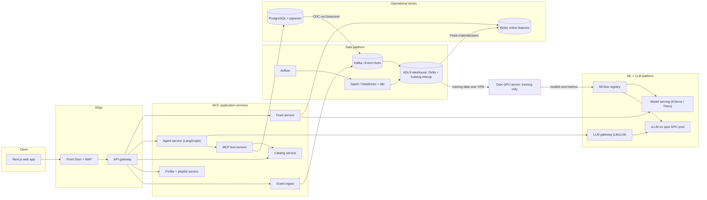

# Resonance — Conversational, Explainable Music Discovery (Azure version)

> **Alternative target.** The main spec is [spec.md](spec.md) (AWS). This version keeps the original
> Azure design; the Terraform for it lives in `infra/terraform/azure/` ([ADR-0004](adr/0004-aws-primary-azure-secondary.md)).

| | |
|---|---|
| **Type** | Consumer web app, built as a portfolio-grade end-to-end system |
| **Emphasis** | AI / ML engineering, with real depth in Data, DevOps and Cloud |
| **Cloud** | Microsoft Azure (about USD 900 of credits) |
| **Own hardware** | One GPU server (RTX 5090, 32 GB VRAM), used for training and fine-tuning only, never for serving |
| **Goal** | Career portfolio that shows production-grade skills across the AI Engineer, ML Engineer, DevOps, Cloud Architect and Data Engineer paths |

---

## 1. Summary

Resonance is a music discovery app with two ways to find music. A personalized feed learns from what you listen to. A chat lets you describe a vibe in plain language ("rainy-day jazz that isn't too slow") and returns a playlist where every track comes with a grounded explanation of why it was picked.

Under the hood it is a deliberately complete system: a lakehouse fed by batch and streaming data, a hybrid recommender trained on your own GPU, a fine-tuned small language model, a retrieval-augmented agent that uses tools, and a GitOps-delivered Kubernetes platform on Azure with full observability and cost control.

The app is the excuse. The real deliverable is evidence that you can design, build, operate and evaluate each layer of a modern AI product.

### Why music

- Open, realistic data exists: catalog metadata, real listening histories (implicit feedback), and Creative Commons audio.
- Recommendation is a genuine ML problem with well-understood metrics.
- Natural-language requests ("sad but danceable") are a good fit for LLMs with tools.
- Audio gives a cold-start problem that content embeddings solve, which justifies a multimodal model.
- Users generate a constant stream of events (plays, skips, likes), which justifies real streaming infrastructure.

---

## 2. Goals and non-goals

### Goals

1. Cover all five career paths with non-trivial, justified use of each technology.
2. Every major technology choice is recorded as an Architecture Decision Record (ADR), including when you would choose differently.
3. Fully reproducible: one command brings up a local development stack, and Terraform plus GitOps bring up the cloud stack.
4. Cost-controlled: the whole thing fits inside the Azure credits through scale-to-zero, scheduling and budgets.
5. Measured: offline metrics, online (simulated) experiments, LLM evals and SLOs are published, not assumed.

### Non-goals

- Streaming copyrighted music or any licensing negotiation. Only Creative Commons audio is used, with attribution.
- Acquiring real users. Traffic comes from a simulator seeded with real listening patterns.
- A native mobile app (listed under stretch goals).
- Maximizing recommender accuracy at any cost. The goal is a defensible, well-evaluated system.

---

## 3. Product description

### 3.1 User journeys

| ID | Journey | Description |
|---|---|---|
| J1 | Onboarding | Import a public ListenBrainz username, or pick 5 seed artists. A taste profile is built within seconds. |
| J2 | Home feed | Sections such as "Because you played X", "New to you", and "Sounds like your favorites" (audio-based, helps with new tracks). A slider controls familiar versus adventurous. |
| J3 | Vibe chat | The user types a request. The agent clarifies if needed, searches the catalog, builds a playlist and explains each pick. |
| J4 | Explain | "Why this track?" shows the signals used and retrieved facts about the artist or release, with citations. |
| J5 | Playlist and feedback | Like, skip, save, edit a playlist. Every interaction becomes an event. |
| J6 | Operator dashboards | Internal views of model metrics, A/B results, LLM cost per request, SLOs and cloud spend. |

### 3.2 Example chat

> **User:** Something for a long night drive. Mellow electronic, no vocals, nothing before 2000.
> **Resonance:** Here are 15 tracks. I filtered to instrumental, electronic, released 2000 or later, with low energy and mid-tempo. *Track 3* is by an artist often described as a pioneer of ambient techno (source: artist biography). *Track 9* is quieter than the rest and acts as a palate cleanser. Want it darker or more upbeat?

The structured part of the request (instrumental, era, energy) is extracted by the fine-tuned intent model. The rest is retrieval, ranking and explanation.

### 3.3 Functional requirements

- FR-1: Authenticate users via OIDC (Microsoft Entra External ID).
- FR-2: Import listening history from a public ListenBrainz profile.
- FR-3: Serve a personalized feed from a recommender with at least two stages (retrieval, ranking).
- FR-4: Provide a natural-language search and playlist builder backed by an agent with tools.
- FR-5: Provide explanations with citations drawn from retrieved text.
- FR-6: Record all interactions as events and make them available for training within minutes (streaming) and in daily batch marts.
- FR-7: Show license and attribution for every track played.
- FR-8: Expose an operator dashboard.

### 3.4 Non-functional targets (initial)

| Area | Target |
|---|---|
| Feed latency | p95 under 300 ms (excluding LLM calls) |
| Chat | first token under 2 s, full playlist under 10 s |
| Availability | 99.5 % monthly SLO for the demo environment, with error budgets and alerts |
| Event freshness | event to online feature under 60 s |
| Cost | stay within credits; LLM cost per chat session tracked and capped |
| Security | no secrets in repos, least-privilege identities, signed images, WAF at the edge |

---

## 4. Data sources

Always verify each dataset's current license and attribution rules before use.

| Source | Content | Used for |
|---|---|---|
| MusicBrainz database dumps | Artists, releases, recordings, tags, relationships | Catalog backbone, metadata features |
| ListenBrainz public listen dumps | Real, anonymized listening events | Implicit feedback for training and simulation seeds |
| Free Music Archive (FMA) dataset | CC-licensed audio clips with genre labels and metadata | Audio embeddings, playable previews |
| Wikipedia / Wikidata | Artist and album text | RAG corpus (CC BY-SA, attribution required) |
| Simulator (own) | Synthetic users and sessions | Load tests, A/B experiments, streaming demo |

### 4.1 Simulator

A behavior simulator turns real listening patterns into synthetic users. It samples a user taste vector, plays tracks with realistic skip and session behavior, and responds to the recommendations it is served. It drives both load tests (k6 or Locust at the edge) and the experiment framework, and it is the reason online A/B metrics can be compared without real users. Document its assumptions honestly: simulated CTR is not real CTR.

---

## 5. Architecture



### 5.1 Service responsibilities

| Service | Language | Responsibility |
|---|---|---|
| Feed | Python (FastAPI) | Candidate retrieval (ANN), online features from Redis, ranking, diversity re-rank, experiment assignment |
| Agent | Python (FastAPI + LangGraph) | Conversation state, planning, tool calls, explanation composition, guardrails |
| Catalog | Python (FastAPI) | Track and artist lookup, hybrid search (text + audio embedding), license metadata |
| Profile and playlist | Python (FastAPI) | Users, taste profile, playlists, import jobs |
| Event ingest | Go (stretch: otherwise Python) | High-throughput validation and publish to Kafka |
| MCP servers | Python | Expose catalog search, profile read, playlist create and facts lookup as tools with strict schemas |
| Web | TypeScript (Next.js) | UI, auth flow, streaming chat rendering |

---

## 6. Technology map by career path

### 6.1 AI Engineer

| Capability | Technology | Notes |
|---|---|---|
| Agent orchestration | LangGraph | Stateful graph: understand, plan, retrieve, rank, compose, explain, safety check |
| Tool protocol | MCP servers | Catalog, profile, playlist, facts tools with typed schemas |
| RAG | Hybrid retrieval (BM25 + dense) with a reranker, on pgvector or Qdrant | Corpus from Wikipedia and MusicBrainz annotations, citations required |
| Fine-tuned small LLM | QLoRA on 3–8B model (a 14B model is likely feasible on 32 GB) | Natural-language request to structured query filters, plus explanation style |
| Serving | vLLM on an autoscaled spot GPU pool | Scale to zero when idle |
| Gateway | LiteLLM with Azure OpenAI fallback | Routing, retries, caching, budgets, per-feature cost tracking |
| Structured output | Pydantic schemas, constrained decoding (Outlines or vLLM guided decoding) | No free-text parsing in the hot path |
| Evaluation | Ragas plus a custom harness, LLM-as-judge calibrated against human labels | Runs in CI on every prompt or model change |
| Tracing | Langfuse or Phoenix with OpenTelemetry | Prompt versions, token cost, latency |
| Guardrails | Content safety filtering, prompt-injection defenses, output validators | Catalog text is untrusted input |

### 6.2 ML Engineer

| Capability | Technology | Notes |
|---|---|---|
| Retrieval model | PyTorch two-tower | User tower (history sequence + features), item tower (ids + metadata + audio embedding) |
| Ranking model | LightGBM or CatBoost (LambdaRank) | Tabular features: popularity, recency, session context, audio similarity |
| Sequence model | Transformer next-track model (SASRec-style) | Ensemble member or alternative, compared in offline eval |
| Audio encoder | Contrastive fine-tune of a pretrained audio model | Cold-start for tracks with no listens |
| Baselines | Popularity, item-kNN, implicit ALS | Every claim of improvement is against baselines |
| Experiment tracking | MLflow (tracking, registry) | Stage transitions gate deployment |
| Hyperparameters | Optuna | Budgeted sweeps on the GPU server |
| Features | Feast (offline lake, online Redis) | Point-in-time correctness, training-serving skew checks |
| Dataset versioning | DVC or lakeFS | Reproducible training sets |
| Serving | ONNX export, KServe or Triton | Towers are small and can serve on CPU |
| Monitoring | Evidently | Data drift, embedding drift, performance decay |
| Training environment | Docker + CUDA + PyTorch (bf16, torch.compile) on your GPU server | Pulls data from the lakehouse, pushes artifacts to the registry |

### 6.3 DevOps

| Capability | Technology | Notes |
|---|---|---|
| CI | GitHub Actions | Lint, test, build, scan, sign, publish; path-filtered monorepo pipelines |
| Containers | Docker multi-stage builds | Slim, non-root images |
| Packaging | Helm (and Kustomize overlays) | One chart per service |
| GitOps | Argo CD | Declarative environments, drift detection |
| Progressive delivery | Argo Rollouts | Canary with automated analysis against SLO metrics |
| Autoscaling | KEDA | Includes GPU pool scale-to-zero and Kafka-lag-based scaling |
| Secrets | External Secrets Operator + Azure Key Vault | No secrets in Git |
| Policy | Kyverno | Enforce non-root, resource limits, signed images |
| Supply chain | Trivy, Syft (SBOM), Cosign, provenance attestations | Verified at admission |
| Observability | OpenTelemetry to Prometheus, Grafana, Loki, Tempo | One trace from browser to model server |
| SLOs | Sloth or Pyrra | Error-budget alerts |
| Resilience | Chaos Mesh, k6 | Game days with written postmortems |
| Config management | Ansible | Provision the GPU server (drivers, Docker, runner, WireGuard) |
| Dependency hygiene | Renovate | Automated update PRs |

### 6.4 Cloud Architect

| Capability | Technology | Notes |
|---|---|---|
| Landing zone | Azure subscriptions per environment, management groups, Azure Policy | Naming, tagging and allowed-region policies |
| IaC | Terraform (modules for network, aks, data, security, observability), remote state | Environments via workspaces or directories, drift detection in CI |
| Compute | AKS with system, app and spot-GPU node pools | Workload identity instead of stored credentials |
| Edge | Front Door with WAF and CDN | TLS, rate limiting, geo rules |
| Identity | Microsoft Entra External ID (consumer OIDC), managed identities | |
| Data | ADLS Gen2, Azure Database for PostgreSQL (flexible), Azure Cache for Redis, Event Hubs (Kafka endpoint) | Private endpoints everywhere |
| Analytics | Azure Databricks (check that credits cover it) or Spark on AKS | |
| Network | Hub-and-spoke VNet, private endpoints, NSGs | WireGuard or VPN link to your GPU server |
| Security | Key Vault, Defender for Cloud, Azure Policy | |
| FinOps | Budgets and alerts, cost tags, Infracost in pull requests | |
| Resilience | Backups, a documented RTO and RPO, a tested restore | |
| Documentation | ADRs, architecture diagrams, a Well-Architected style review | |

### 6.5 Data Engineer

| Capability | Technology | Notes |
|---|---|---|
| Storage | ADLS Gen2 with Delta tables (Iceberg readable through interoperability) | Medallion layout |
| Batch processing | Spark (PySpark) | MusicBrainz and ListenBrainz ingestion, feature backfills |
| Transformation | dbt | Silver to gold marts, tests, docs |
| Orchestration | Airflow | Dependency-aware DAGs, backfills, SLAs |
| Streaming | Kafka (Event Hubs Kafka endpoint or Strimzi) with Spark Structured Streaming or Flink | Event to online feature in under 60 s |
| CDC | Debezium from PostgreSQL | Keeps the lake in sync with operational data |
| Quality | dbt tests, Great Expectations | Contracts on event schemas |
| Lineage and catalog | OpenLineage, a catalog tool of your choice | Column-level lineage for key marts |
| Serving layer | PostgreSQL + pgvector, Redis | Operational reads |

---

## 7. Detailed design

### 7.1 Data platform

**Zones**

- **Bronze**: raw, immutable, append-only copies of dumps and events, with ingestion metadata.
- **Silver**: cleaned, typed, deduplicated, conformed entities (tracks, artists, listens, users, sessions).
- **Gold**: analytics and ML-ready marts (user-item interactions, item popularity by day, session features, training datasets).

**Key tables**: `listens`, `tracks`, `artists`, `release_groups`, `tags`, `users_sim`, `sessions`, `events_play`, `events_skip`, `events_like`, `item_features`, `user_features`, `training_examples`, `experiment_assignments`.

**Batch pipelines (Airflow DAGs)**

1. `ingest_musicbrainz` (monthly) and `ingest_listenbrainz` (incremental)
2. `ingest_fma_audio_and_metadata`
3. `build_silver` then `dbt_gold`
4. `materialize_features` (offline to online via Feast)
5. `build_training_sets` (time-based splits, label construction)
6. `quality_and_lineage_report`

**Streaming pipelines**

- Event ingest publishes `play`, `skip`, `like`, `search` and `chat_feedback` events to Kafka with schemas and a schema registry.
- A streaming job computes session and recency features and writes to Redis and to the lake.
- Debezium captures playlist and profile changes.
- Late and duplicate events are handled explicitly (watermarks and idempotent upserts).

**Engineering practices**

- Slowly changing dimension (Type 2) for catalog changes.
- Partitioning and compaction strategy documented with numbers from the real tables.
- Backfill procedure tested end to end.
- Data quality failures block downstream DAGs and raise alerts.

### 7.2 ML platform

**Training data**

- Implicit feedback from listens. Positives are completed plays or repeats. Negatives come from skips plus sampled negatives.
- Time-based train, validation and test splits to avoid leakage. Leakage checks are automated.

**Models**

| ID | Model | Purpose |
|---|---|---|
| M1 | Two-tower retrieval | Candidate generation, served with an ANN index (HNSW) |
| M2 | LambdaRank ranker (LightGBM or CatBoost) | Rank retrieved candidates with rich features |
| M3 | Sequential transformer | Session-aware next-track prediction, ensemble candidate |
| M4 | Audio encoder | Embeddings for cold-start and "sounds like" search |
| M5 | Intent LLM (QLoRA) | Natural-language request to structured filters |

**Offline evaluation**: Recall@K, NDCG@K, MAP, plus beyond-accuracy metrics (coverage, novelty, diversity, calibration). Slice results by user activity level and by new versus old tracks.

**Online evaluation (simulated)**: feature-flagged A/B tests and interleaving, with guardrail metrics (latency, error rate, diversity floors). Document the simulator's limits.

**Release path**: registry stage `candidate` then shadow traffic, then canary, then full. Rollback is one Git revert.

**Monitoring**: feature skew between training and serving, drift in input and embedding distributions, rolling offline-metric replay on fresh data, and automatic retraining triggers handled by the orchestrator.

**GPU server workflow**

1. A scheduled or manual job (via a self-hosted CI runner) pulls a versioned dataset from the lake.
2. Training runs in a pinned container with a fixed seed and logged environment.
3. Metrics and artifacts are logged to MLflow.
4. Passing models are exported (ONNX, quantized weights) and promoted in the registry.
5. GitOps rolls out the new version; no manual copying of files to production.

### 7.3 LLM and agent platform

**Agent graph (LangGraph)**

1. **Understand**: the intent model extracts filters (genre, era, energy, vocals, tempo) and a free-text mood.
2. **Plan**: decide whether to clarify, search or refine.
3. **Retrieve**: hybrid catalog search (text plus audio embedding similarity) through MCP tools.
4. **Rank**: reuse the recommender ranker with user features so results are personal.
5. **Compose**: build the playlist under constraints (length, variety, flow).
6. **Explain**: generate per-track explanations grounded in retrieved text, with citations.
7. **Safety check**: validate output schema, filter unsafe content, check that cited sources exist.

**RAG pipeline**: ingest, clean, chunk by section, embed, index with metadata, hybrid retrieve, rerank, and cite. Re-index on a schedule via the orchestrator.

**Fine-tuning plan**

- Generate synthetic request and structured-output pairs with a stronger model, then verify a sample by hand.
- Train with QLoRA on the GPU server, compare against the base model and a prompt-only baseline.
- Quantize (AWQ or GGUF) and serve with vLLM.
- Report accuracy, latency and cost against the larger hosted model so the trade-off is explicit.

**Gateway**: all model calls go through a single gateway that handles routing (own model first, hosted fallback), retries, caching, budgets and per-feature accounting.

**Guardrails**

- Catalog and Wikipedia text are untrusted: prompt-injection tests are part of the eval suite.
- Tool schemas are strict. The agent can only create playlists for the authenticated user.
- Rate limits, token budgets and a kill switch.
- PII is never sent to third-party models.

**Evaluation (run in CI)**

- Golden set of 200–300 requests with expected constraints.
- Metrics: intent accuracy, constraint satisfaction rate, groundedness and citation validity, latency, cost per session.
- LLM-as-judge is calibrated against a human-labeled subset, and the agreement is reported.

### 7.4 Application layer

- FastAPI services with OpenAPI contracts, consumer-driven contract tests between services.
- Next.js frontend with streaming chat, accessible components, and a license and attribution footer on every player.
- Authentication through OIDC with short-lived tokens; authorization checks in each service.

### 7.5 DevOps design

**Repository layout (monorepo)**

```
resonance/
  apps/            web, feed, agent, catalog, profile, ingest, mcp-servers
  ml/              training code, configs, evaluation, notebooks (exploration only)
  data/            dbt project, airflow dags, streaming jobs, schemas
  llm/             prompts, eval sets, fine-tuning code, rag pipeline
  platform/        helm charts, argo apps, kyverno policies, kustomize overlays
  infra/           terraform modules and environments, ansible playbooks
  sim/             user behavior simulator, k6 or locust scenarios
  docs/            ADRs, architecture, runbooks, postmortems, blog drafts
  Makefile         up, down, test, lint, demo targets
```

**CI pipeline (per pull request)**: format and lint, unit tests, contract tests, build images, scan (dependencies and images), SBOM, LLM eval subset, Terraform plan with cost estimate, preview environment (optional).

**CD**: merge to main publishes signed images and updates the GitOps repository. Argo CD syncs. Argo Rollouts runs canary analysis against SLO queries and aborts automatically on regression.

**Environments**: `local` (kind or k3d, docker compose for data services), `dev`, `prod` (the demo). Dev scales down outside working hours.

**Operations**: dashboards per service, golden signals, SLO burn-rate alerts, a runbook for each alert, and an on-call style incident log. Game days inject failures (pod kill, latency, dependency outage, bad deploy) and each produces a short postmortem.

### 7.6 Cloud design (Azure)

**Topology**

- Hub-and-spoke network. Spokes per environment. Private endpoints for storage, database, cache, Key Vault and Event Hubs.
- AKS with three node pools: system, application (autoscaled), spot GPU (scale to zero).
- Front Door and WAF at the edge, optional API Management as the gateway.
- Workload identity for pods, with no stored cloud credentials.
- A secure link (WireGuard or VPN) between the VNet and your GPU server for dataset pulls and artifact pushes.

**Security baseline**: least-privilege roles, Defender for Cloud recommendations tracked, Key Vault with rotation, network policies, image signature verification, centralized logs.

**Resilience**: documented RTO and RPO targets, database backups and a restore drill, infrastructure rebuilt from code in a clean subscription as a test.

**Cost control (important with limited credits)**

| Tactic | Detail |
|---|---|
| Budgets and alerts | Thresholds at 50, 80 and 100 percent of the credit plan |
| Scale to zero | GPU node pool and non-critical workloads scale down when idle |
| Schedules | Dev environment auto-stops overnight and at weekends |
| Right-sizing | Burstable database tiers, small default node sizes |
| Batch windows | Spark and Databricks jobs run on schedule, clusters terminate when done |
| Cost visibility | Tags per component, a cost dashboard, Infracost on every infrastructure PR |
| LLM spend | Per-session cost recorded, hard daily cap in the gateway |

**Practical checks before you start**: confirm that your credits apply to Databricks and to GPU VM sizes, and request GPU quota early because new subscriptions often start with none.

---

## 8. Security and privacy

- Threat model (STRIDE) for the main flows, kept in the docs folder and updated with each major change.
- Data minimization: only public or simulated data, no real personal data collected.
- Map LLM risks to the OWASP Top 10 for LLM applications (prompt injection, insecure output handling, excessive agency, and so on) and record your mitigations.
- Dependency and image scanning in CI, signed images, admission policies.
- Secrets only in Key Vault, rotated, never in Git or images.
- Rate limiting and abuse protection at the edge and in the gateway.

---

## 9. Testing strategy

| Layer | Approach |
|---|---|
| Unit | Pytest or Vitest, high coverage on business logic |
| Contract | Consumer-driven tests between services, schema compatibility checks for events |
| Integration | Testcontainers for Postgres, Kafka and Redis |
| Data | dbt tests, Great Expectations suites, row-count and freshness checks |
| Model | Offline metrics gates, behavioral and invariance tests, slice checks |
| LLM | Golden set, prompt-injection set, regression comparisons per change |
| Performance | k6 or Locust against the edge, with a published latency and throughput report |
| Resilience | Chaos experiments with expected and observed behavior recorded |
| End to end | Playwright for core user journeys |

---

## 10. Roadmap

Effort is indicative for one person working part-time. Each phase ends with an exit criterion and something demonstrable.

| Phase | Focus | Key deliverables | Exit criterion |
|---|---|---|---|
| 0 | Walking skeleton | Repo, Terraform foundation, AKS, CI/CD, Argo CD, basic observability, one dummy service | A commit reaches the cluster and shows up in dashboards |
| 1 | Batch data platform | Ingestion of MusicBrainz, ListenBrainz and FMA, silver and gold layers, dbt tests, Airflow DAGs | Gold marts rebuild from scratch with passing quality checks |
| 2 | App and streaming | Catalog, profile and event services, web UI, Kafka, CDC, online features | Click in the UI becomes an online feature in under 60 s |
| 3 | Recommender v1 | Baselines, two-tower, ranker, registry, serving, A/B framework | Beats baselines offline and is served behind a flag |
| 4 | LLM layer | RAG, agent, MCP tools, intent fine-tune, gateway, eval harness | Golden set passes thresholds in CI |
| 5 | MLOps automation | Drift monitors, retrain triggers, canary rollout for models | A drift alert triggers a retrain that is promoted or rejected automatically |
| 6 | Hardening | Policies, SLOs, chaos game days, load tests, FinOps, DR drill | Published SLO report and two postmortems |
| 7 | Packaging | Diagrams, ADRs, benchmarks, demo video, public repository | A stranger can understand and run the project from the README |

---

## 11. Portfolio packaging

### 11.1 ADRs to write (examples)

1. Why a medallion lakehouse, and Delta versus Iceberg.
2. Why Airflow (and when Dagster would win).
3. Event Hubs Kafka endpoint versus self-managed Kafka.
4. Two-stage recommender versus a single model.
5. pgvector versus a dedicated vector database.
6. Own fine-tuned model plus gateway fallback versus hosted-only.
7. LangGraph versus a plain state machine.
8. GitOps with Argo CD versus push-based CD.
9. AKS node pool design and GPU scale-to-zero.
10. Where GPU training lives (own hardware) versus where serving lives (cloud).
11. Cost-control strategy and its measured results.
12. Tenant and identity model for consumer authentication.

### 11.2 Artifacts to publish

- Architecture diagrams (context, container, data flow, deployment).
- A benchmark report: offline metrics, LLM evals, latency and cost.
- Six short write-ups, for example "Evaluating a recommender without real users", "Fine-tuning a small model on one GPU: what it bought us", "Running GPU inference on spot nodes with scale-to-zero", "Keeping an AI app inside a cloud credit budget".
- A three-minute demo video and a one-page summary for recruiters.
- A clean README with a quick start (`make up`) and a "what to look at first" guide.

---

## 12. Risks and mitigations

| Risk | Mitigation |
|---|---|
| Scope is huge | Build in vertical slices; every phase must work end to end before the next starts |
| Credits run out | Budgets, scale-to-zero, schedules, a cost review at every phase |
| GPU quota or credit limits block cloud GPUs | Request early; fall back to hosted model endpoints behind the gateway |
| Simulator results mislead | State its assumptions and treat online results as relative, not absolute |
| Dataset license mistakes | Keep a license register and surface attribution in the app |
| Tool sprawl for its own sake | One tool per slot, justified in an ADR |
| LLM quality regressions | Eval gates in CI and versioned prompts |

---

## 13. Stretch goals

- React Native client or a progressive web app with offline playlists.
- A graph neural network or a multi-task ranker.
- Feature flags with a proper experimentation platform (GrowthBook or Unleash).
- Multi-region active-passive deployment.
- An internal developer portal (Backstage) describing all services.
- A second cloud deployment target to prove portability.

---

## 14. Definition of done

- [ ] All five technology paths have a working, documented component in production-like use.
- [ ] Reproducible local and cloud deployments from a clean checkout.
- [ ] Offline metrics, LLM evals, load tests and SLO reports published.
- [ ] At least two game days with postmortems.
- [ ] At least ten ADRs with trade-offs.
- [ ] Cost report showing the system fit inside the credit budget.
- [ ] Public repository, architecture diagrams and a demo video.
